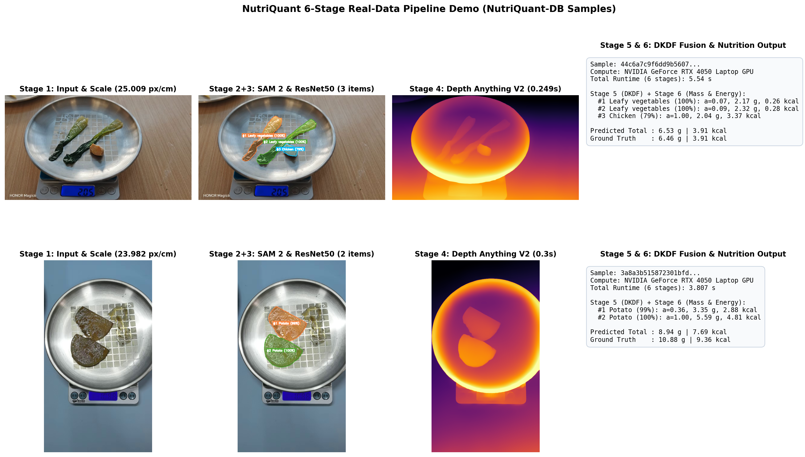

# NutriQuant & NutriQuant-DB

Official implementation and local interactive web demo for **NutriQuant**:

> **Single-Image Smartphone Quantification of Canteen Meal Portions and Estimated Energy Intake**

NutriQuant estimates per-component food **volume ($\text{cm}^3$), mass ($\text{g}$), and estimated energy ($\text{kcal}$)** from a single RGB cafeteria photograph without requiring a depth camera or hosted cloud GPU.

```text
RGB Photo ──▶ [1] Perspective & Scale (px/cm)
          ──▶ [2] CLAHE + SAM 2 Instance Segmentation
          ──▶ [3] ResNet50 Category Recognition (10 classes, gate p >= 0.70)
          ──▶ [4] Depth Anything V2 Monocular Depth & Height Calibration
          ──▶ [5] Data-Knowledge-Driven Adaptive Fusion (DKDF: V_geo + V_depth)
          ──▶ [6] Cooked-Food Density & USDA SR28 Energy Output
```

---

## Live Visual Demo Preview (Real NutriQuant-DB Data)

Below is an actual end-to-end run of the 6-stage pipeline (`python demo_app.py`) on real cafeteria samples from `data/test_images/`, showing Stage 1 scale recovery, Stage 2 + 3 SAM 2 masks & ResNet50 predictions, Stage 4 Depth Anything V2 relative depth heatmaps, and Stage 5 + 6 DKDF mass & calorie outputs compared against electronic-scale ground truth:



---

## Important Note on Compute Resources

We **do not host a remote GPU inference server**. To run the interactive HTML demo (`demo_app.py`) or CLI inference (`main.py`), please configure Python and PyTorch on **your own local machine**:

- **Recommended:** NVIDIA GPU with CUDA (e.g., 6 GB+ VRAM; runs all 6 stages in ~3–5 s per image).
- **Fallback:** CPU-only execution also works out of the box (slower, ~20–45 s per image depending on CPU).

---

## Step 1: Clone the Repository & Set Up Local Environment

### 1.1 Clone with Git LFS

Large weights and the protected dataset archive are tracked via **Git LFS**. Install Git LFS once before cloning:

```bash
git lfs install
git clone https://github.com/fanzhaorui744/NutriQuant-DB.git
cd NutriQuant-DB
git lfs pull
```

### 1.2 Create a Python Environment (Python 3.10 or 3.11)

Using Conda (recommended):

```bash
conda create -n nutriquant python=3.10 -y
conda activate nutriquant
```

Or using standard `venv`:

```bash
python -m venv .venv
# Windows PowerShell:
.venv\Scripts\Activate.ps1
# Linux / macOS:
# source .venv/bin/activate
```

### 1.3 Install PyTorch (Matching Your Local Compute) & Dependencies

First install `torch` and `torchvision` matching your local GPU CUDA version (see [PyTorch Get Started](https://pytorch.org/get-started/locally/)):

```bash
# Example for NVIDIA CUDA 11.8:
pip install torch torchvision --index-url https://download.pytorch.org/whl/cu118

# Example for CPU-only machines:
# pip install torch torchvision
```

Then install the remaining pipeline dependencies:

```bash
pip install -r requirements_demo.txt
```

*(No extra web framework is required—the local HTML demo server uses Python's built-in `http.server`.)*

---

## Step 2: Download Public Pretrained Models & Verify Checkpoints

NutriQuant builds upon two open-source vision foundation models plus our fine-tuned 10-category ResNet50 food classifier. If `git lfs pull` already populated `checkpoints/` and `result/`, you can verify them directly; otherwise download the public models from their official sources below (or run `python download_models.py`):

| Component | Stage | Public Source / Repository | Direct Checkpoint Download | Local Path in Repo |
| :--- | :--- | :--- | :--- | :--- |
| **SAM 2 (Hiera-Tiny)** | Stage 2 (Segmentation) | [facebookresearch/sam2](https://github.com/facebookresearch/sam2) | [`sam2_hiera_tiny.pt`](https://dl.fbaipublicfiles.com/segment_anything_2/072824/sam2_hiera_tiny.pt) ([HF mirror](https://huggingface.co/facebook/sam2-hiera-tiny)) | `checkpoints/sam2_t.pt` |
| **Depth Anything V2 (ViT-S)** | Stage 4 (Monocular Depth) | [DepthAnything/Depth-Anything-V2](https://github.com/DepthAnything/Depth-Anything-V2) | [`depth_anything_v2_vits.pth`](https://huggingface.co/depth-anything/Depth-Anything-V2-Small/resolve/main/depth_anything_v2_vits.pth) ([HF Hub](https://huggingface.co/depth-anything/Depth-Anything-V2-Small)) | `checkpoints/depth_anything_v2_vits.pth` |
| **Food Classifier (ResNet50)** | Stage 3 (10-Class Recognition) | ImageNet-pretrained `torchvision` ResNet50 fine-tuned on NutriQuant-DB | Included via Git LFS (or train via `python recognition.py`) | `result/food_classifier.pth` |
| **Calibration & RF Regressors** | Stage 5 (Shape Calibration) | Fitted on NutriQuant-DB training split | Included via Git LFS | `calibration_params.json`, `models/rf_regressors/*.pkl` |

Optional larger Depth Anything V2 encoders (if you change `encoder` to `'vitb'` or `'vitl'` in `pipeline_demo.py`):
- Base (`vitb`): `https://huggingface.co/depth-anything/Depth-Anything-V2-Base/resolve/main/depth_anything_v2_vitb.pth`
- Large (`vitl`): `https://huggingface.co/depth-anything/Depth-Anything-V2-Large/resolve/main/depth_anything_v2_vitl.pth`

### Automatic Model Download Helper

If `checkpoints/sam2_t.pt` or `checkpoints/depth_anything_v2_vits.pth` is missing (or is only a small Git LFS pointer), run:

```bash
python download_models.py
```

### Runtime Execution Order of Models

When an image is submitted, the pipeline executes models in the following sequence:
1. **Perspective / Scale Estimator (`perspective.py`)**: Detects the $1 \times 1\text{ cm}^2$ fiducial grid homography (or plate circle fallback) to obtain rectified scale $s$ ($\text{px/cm}$).
2. **SAM 2 (`segmentation.py` -> `checkpoints/sam2_t.pt`)**: Applies CLAHE if luminance $\sigma_I < 30.0$, runs `SAM2AutomaticMaskGenerator`, and refines candidate food masks.
3. **ResNet50 (`recognition.py` -> `result/food_classifier.pth`)**: Classifies each 10-pixel padded food crop into one of the 10 cooked-food categories and checks the softmax confidence gate ($p_{\hat{c}} \ge 0.70$).
4. **Depth Anything V2 (`depth.py` -> `checkpoints/depth_anything_v2_vits.pth`)**: Predicts relative inverse depth $D_{rel}(i,j)$, anchors it locally to the plate background $D_{bg}$ and known rim height $h_{ref}=2.0\text{ cm}$, and integrates depth volume $V_{depth}$.
5. **DKDF Fusion (`volume.py` + `models/rf_regressors/*.pkl`)**: Computes geometric proxy $V_{geo}$, depth contrast $q$ and normalized $s_{depth} = \operatorname{clip}(q, 0, \lambda)/\lambda$ ($\lambda = 5.5$), applies confidence-gated category prior $\widetilde{\delta}_{\hat{c}} \in \{+0.3, -0.2, 0.0\}$, and fuses $\hat{V} = \alpha V_{geo} + (1-\alpha) V_{depth}$.
6. **Mass & Energy Conversion (`nutrition.py`)**: Converts $\hat{V}$ to mass $\hat{m}_c = \rho_c \hat{V}_c$ using measured cooked-food densities and calculates estimated energy $\hat{E}_c = \hat{m}_c \cdot e_c$ using USDA SR28 coefficients.

---

## Step 3: Launch the Local HTML Web Demo

Once your environment and checkpoints are ready, launch the local backend and interactive HTML interface with one command:

```bash
python demo_app.py
```

Optional flags:
- `--port 7860` (default port `7860`)
- `--host 127.0.0.1`
- `--no-browser` (do not auto-open the web browser)
- `--preload` (preload SAM 2, ResNet50, and Depth Anything V2 at server startup)

Then open **`http://127.0.0.1:7860`** in your browser:
1. **Upload your own meal photo** (drag & drop JPG/PNG) **or click one of the bundled real NutriQuant-DB samples**.
2. Click **"Run 6-Stage NutriQuant Pipeline"**.
3. Inspect the **SAM 2 segmentation overlay**, **Depth Anything V2 depth heatmap**, per-item **DKDF routing weights ($\alpha$, $q$, confidence gate)**, and **total predicted mass ($\text{g}$) & estimated energy ($\text{kcal}$)**.

### Alternative: Command-Line Demo & Batch Evaluation

Run quick CLI inference on sample images:
```bash
python main.py --max-images 3
```

Run batch evaluation and generate metrics reports (`MAE / RMSE / MAPE`):
```bash
python evaluate_and_report.py --max-images 5
```

---

## Full Image Dataset Access (Password-Protected Archive)

The complete **NutriQuant-DB** image dataset (**786 cafeteria images**, **2,094 annotated food instances** across **10 cooked-food categories**, CVAT XML & CSV annotations) is packaged as a password-protected ZIP archive in this repository:

- Archive path: [`dataset/NutriQuant-DB_images_protected.zip`](dataset/NutriQuant-DB_images_protected.zip)
- SHA-256 checksum: [`dataset/NutriQuant-DB_images_protected.zip.sha256`](dataset/NutriQuant-DB_images_protected.zip.sha256)
- Dataset card & format specification: [`DATASET.md`](DATASET.md)

To protect data governance and prevent unauthorized redistribution, the archive is encrypted. **If you need the decryption password for academic research, please contact the authors (`fanzhaorui744@gmail.com` or the corresponding author listed in the manuscript) with your name, institution, and brief research purpose.**

*(A small subset of sample test images is already included in `data/test_images/` so you can run the interactive demo immediately after cloning.)*

---

## Repository Structure

```text
.
|- demo_app.py                     # Local HTTP server + API backend for the HTML UI
|- web/index.html                  # Interactive 6-stage HTML frontend
|- pipeline_demo.py                # Unified 6-stage NutriQuant + DKDF inference engine
|- main.py                         # CLI demo script
|- download_models.py              # Public model downloader (SAM 2 + Depth Anything V2)
|- perspective.py                  # Stage 1: Homography rectification & scale recovery
|- segmentation.py                 # Stage 2: SAM 2 automatic mask generator wrapper
|- recognition.py                  # Stage 3: ResNet50 food category classifier
|- depth.py                        # Stage 4: Depth Anything V2 wrapper
|- volume.py                       # Stage 5: Ellipsoid proxy + DKDF adaptive fusion
|- nutrition.py                    # Stage 6: Measured cooked-food densities & USDA SR28 kcal
|- evaluate_and_report.py          # Batch evaluation script
|- analysis.py                     # Error metrics & consistency analysis
|- calibration_params.json         # Per-category calibration & normalization metadata
|- checkpoints/                    # SAM 2 & Depth Anything V2 checkpoints (Git LFS)
|- models/rf_regressors/           # Per-category shape-calibration regressors (Git LFS)
|- result/                         # Fine-tuned 10-class ResNet50 weights & class list
|- data/test_images/               # Ready-to-run real sample photos for the demo
|- data/ground_truth.csv           # Electronic-scale ground-truth weights for test samples
|- dataset/                        # Password-protected full 786-image NutriQuant-DB archive
|- assets/demo_6stage_real.png     # Real-data 6-stage visual preview
|- vendor/                         # Bundled SAM 2 & Depth Anything V2 source modules
`- requirements_demo.txt           # Python package dependencies
```

---

## Citation

If you find **NutriQuant** or **NutriQuant-DB** useful in your research, please cite:

```bibtex
@article{nutriquant2026,
  title   = {Single-Image Smartphone Quantification of Canteen Meal Portions and Estimated Energy Intake},
  author  = {Fan, Zhaorui and others},
  journal = {Food Science and Human Wellness},
  year    = {2026}
}
```
