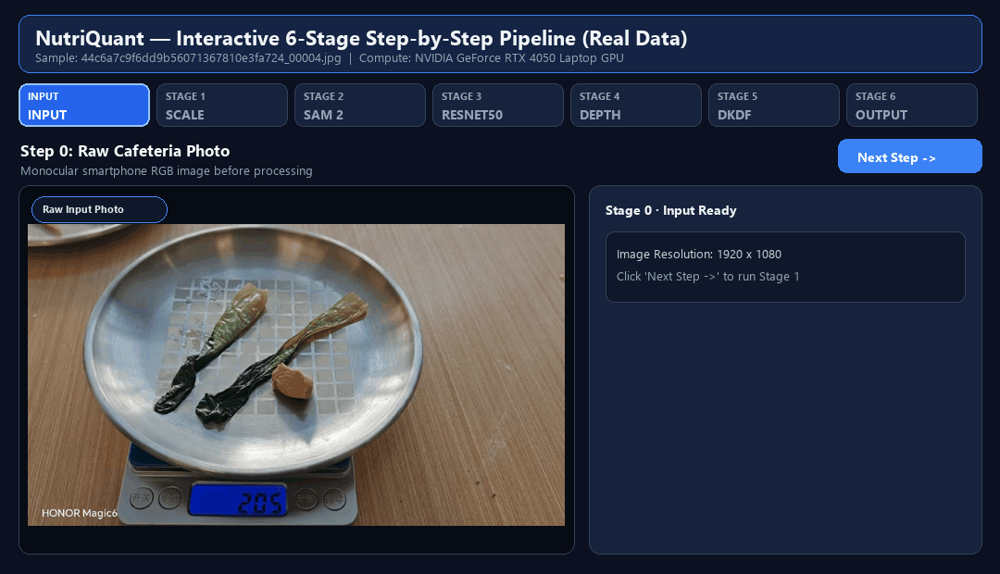

# NutriQuant & NutriQuant-DB

[](https://fanzhaorui744.github.io/NutriQuant-DB/)
[-10b981?style=for-the-badge)](https://drive.google.com/file/d/1uRg9CPDsKoWgD67H2SViRSOsQahn2OAR/view?usp=sharing)

Official implementation and interactive step-by-step demo for **NutriQuant**:

> **Single-Image Smartphone Quantification of Canteen Meal Portions and Estimated Energy Intake**

NutriQuant estimates per-component food **volume (cm³), mass (g), and estimated energy (kcal)** from a single RGB cafeteria photograph without a depth camera or hosted cloud GPU.

```text
RGB Photo ──▶ [1] Perspective & Scale (px/cm)
          ──▶ [2] CLAHE + SAM 2 Instance Segmentation
          ──▶ [3] ResNet50 Category Recognition (10 classes, gate p >= 0.70)
          ──▶ [4] Depth Anything V2 Monocular Depth & Height Calibration
          ──▶ [5] Data-Knowledge-Driven Adaptive Fusion (DKDF: V_geo + V_depth)
          ──▶ [6] Cooked-Food Density & USDA SR28 Energy Output
```

---

## Live Interactive 6-Stage Demo (Click to Try)

- **Online Clickable Web Demo (no installation required):** Open **[https://fanzhaorui744.github.io/NutriQuant-DB/](https://fanzhaorui744.github.io/NutriQuant-DB/)** to step interactively (`Next Step ->` / `Auto Play`) through all 6 stages on real NutriQuant-DB cafeteria samples.
- **Upload Your Own Photos Locally:** Run `python demo_app.py` on your own machine (see Steps 1–3 below).



---

## Important Note on Compute Resources

We **do not host a remote GPU inference server**. To run live inference on your own uploaded photos (`demo_app.py` or `main.py`), please set up Python and PyTorch on **your own local compute**:

- **Recommended:** NVIDIA GPU with CUDA (6 GB+ VRAM; runs all 6 stages in ~3–5 s per image).
- **Fallback:** CPU-only execution also works out of the box (slower, ~20–45 s per image).

---

## Step 1: Clone the Repository & Set Up Local Environment

### 1.1 Clone with Git LFS

Model checkpoints are tracked via **Git LFS**. Install Git LFS once before cloning:

```bash
git lfs install
git clone https://github.com/fanzhaorui744/NutriQuant-DB.git
cd NutriQuant-DB
git lfs pull
```

### 1.2 Create a Python Environment (Python 3.10 or 3.11)

```bash
conda create -n nutriquant python=3.10 -y
conda activate nutriquant
```

*(Or use `python -m venv .venv` and activate `.venv\Scripts\Activate.ps1` on Windows / `source .venv/bin/activate` on Linux/macOS.)*

### 1.3 Install PyTorch (Matching Your Local Compute) & Dependencies

Install `torch` and `torchvision` matching your local GPU CUDA version (see [PyTorch Get Started](https://pytorch.org/get-started/locally/)):

```bash
# Example for NVIDIA CUDA 11.8:
pip install torch torchvision --index-url https://download.pytorch.org/whl/cu118

# Example for CPU-only machines:
# pip install torch torchvision
```

Then install the remaining dependencies:

```bash
pip install -r requirements_demo.txt
```

*(No extra web framework is needed — `demo_app.py` uses Python's built-in `http.server`.)*

---

## Step 2: Download Public Pretrained Models & Execution Order

NutriQuant builds on two public foundation models plus our fine-tuned 10-category ResNet50 classifier. If `git lfs pull` did not fetch `checkpoints/`, or if you prefer downloading from official sources, use the links below or run `python download_models.py`:

| Component | Stage | Public Source / Repository | Direct Checkpoint Download | Local Path in Repo |
| :--- | :--- | :--- | :--- | :--- |
| **SAM 2 (Hiera-Tiny)** | Stage 2 (Segmentation) | [facebookresearch/sam2](https://github.com/facebookresearch/sam2) | [`sam2_hiera_tiny.pt`](https://dl.fbaipublicfiles.com/segment_anything_2/072824/sam2_hiera_tiny.pt) ([HF mirror](https://huggingface.co/facebook/sam2-hiera-tiny)) | `checkpoints/sam2_t.pt` |
| **Depth Anything V2 (ViT-S)** | Stage 4 (Monocular Depth) | [DepthAnything/Depth-Anything-V2](https://github.com/DepthAnything/Depth-Anything-V2) | [`depth_anything_v2_vits.pth`](https://huggingface.co/depth-anything/Depth-Anything-V2-Small/resolve/main/depth_anything_v2_vits.pth) ([HF Hub](https://huggingface.co/depth-anything/Depth-Anything-V2-Small)) | `checkpoints/depth_anything_v2_vits.pth` |
| **Food Classifier (ResNet50)** | Stage 3 (10-Class Recognition) | ImageNet-pretrained `torchvision` ResNet50 fine-tuned on NutriQuant-DB | Included via Git LFS (or train with `python recognition.py`) | `result/food_classifier.pth` |
| **Shape Calibration RF** | Stage 5 (Branch Calibration) | Fitted on NutriQuant-DB training split | Included via Git LFS | `calibration_params.json`, `models/rf_regressors/*.pkl` |

Optional larger Depth Anything V2 encoders:
- Base (`vitb`): `https://huggingface.co/depth-anything/Depth-Anything-V2-Base/resolve/main/depth_anything_v2_vitb.pth`
- Large (`vitl`): `https://huggingface.co/depth-anything/Depth-Anything-V2-Large/resolve/main/depth_anything_v2_vitl.pth`

Quick automatic check / download for SAM 2 and Depth Anything V2:

```bash
python download_models.py
```

### Runtime Execution Order of Models

When an image is submitted, the pipeline executes models in sequence across all 6 stages:

1. **Perspective & Scale Estimator (`perspective.py`)**: Detects the 1 × 1 cm² fiducial grid homography (or circular plate fallback) to recover planar scale `s` (px/cm).
2. **SAM 2 (`segmentation.py` → `checkpoints/sam2_t.pt`)**: Applies CLAHE (`clipLimit=3.0`) if grayscale contrast `σ_I < 30.0`, runs `SAM2AutomaticMaskGenerator`, and refines candidate food masks.
3. **ResNet50 (`recognition.py` → `result/food_classifier.pth`)**: Classifies each 10-pixel padded food crop into one of the 10 cooked-food categories (`rice, tudou, tudousi, lajiao, qingcai, xilanhua, tofu, qiezi, jirou, egg`) and evaluates the softmax confidence gate (`p >= 0.70`).
4. **Depth Anything V2 (`depth.py` → `checkpoints/depth_anything_v2_vits.pth`)**: Predicts relative inverse depth `D_rel(i, j)`, calibrates physical height against local plate background `D_bg` and rim anchor `h_ref = 2.0 cm`, and integrates `V_depth`.
5. **DKDF Adaptive Fusion (`volume.py` + `models/rf_regressors/*.pkl`)**: Computes geometric proxy `V_geo`, depth contrast `q = |mean(D_food) - D_bg| / (sigma_bg + eps)`, normalized `s_depth = clip(q, 0, 5.5) / 5.5`, applies confidence-gated shape prior `delta_tilde` (`+0.3` for `tofu, qiezi, jirou`; `-0.2` for `lajiao, qingcai, xilanhua`; `0.0` otherwise), and fuses `V_hat = alpha * V_geo + (1 - alpha) * V_depth` where `alpha = clip(s_depth + delta_tilde, 0, 1)`.
6. **Mass & Energy Conversion (`nutrition.py`)**: Converts `V_hat` to mass `m_hat = rho_c * V_hat` using measured cooked-food densities and computes estimated energy `E_hat = m_hat * e_c` from USDA SR28 reference entries.

---

## Step 3: Launch the Interactive Local HTML Demo

Start the local web backend and interactive step-by-step HTML interface:

```bash
python demo_app.py
```

Then open **`http://127.0.0.1:7860`** in your browser:
1. **Upload your own meal photo** (drag & drop JPG/PNG) **or select one of the 4 curated real samples**.
2. Click **`Run 6-Stage Pipeline ->`**.
3. Click **`Next Step ->`** (or **`Auto Play`**) to step dynamically from **Input → Scale → SAM 2 Masks → ResNet50 Labels → Depth Anything V2 Heatmap → DKDF Fusion → Mass & Energy**.

For quick terminal inference without the browser UI:

```bash
python main.py
```

---

## Full Image Dataset Access (Restricted Google Drive + Password-Protected ZIP)

The complete **NutriQuant-DB** image dataset (**786 cafeteria images**, **2,094 annotated instances** across **10 cooked-food categories**, CVAT XML & CSV annotations, **256.37 MB**) is hosted on Google Drive with **Restricted access** and **password encryption**:

- **Google Drive (Restricted Access):** [`NutriQuant-DB_images_protected.zip`](https://drive.google.com/file/d/1uRg9CPDsKoWgD67H2SViRSOsQahn2OAR/view?usp=sharing)
- **Dataset Card & Format Spec:** [`DATASET.md`](DATASET.md)

### How to Request Access & Decryption Password
1. Click the Google Drive link above and submit a **Request access** request (or email `fanzhaorui744@gmail.com` / the corresponding author in the manuscript) stating your **name, institution, and academic research purpose**.
2. Once approved, download `NutriQuant-DB_images_protected.zip` and use the decryption password provided upon approval to extract the archive.

*(4 curated demo sample images are included in `data/test_images/` so the interactive demo works immediately after cloning.)*

---

## Repository Structure

```text
.
|- demo_app.py                     # Local HTTP backend for the interactive HTML demo
|- web/index.html                  # Dynamic step-by-step 6-stage HTML UI
|- docs/index.html                 # GitHub Pages live interactive demo (preloaded real samples)
|- pipeline_demo.py                # Unified 6-stage NutriQuant + DKDF inference engine
|- main.py                         # Minimal CLI demo script
|- download_models.py              # SAM 2 & Depth Anything V2 checkpoint downloader
|- perspective.py                  # Stage 1: Homography rectification & scale recovery
|- segmentation.py                 # Stage 2: SAM 2 automatic mask generator wrapper
|- recognition.py                  # Stage 3: ResNet50 10-category classifier
|- depth.py                        # Stage 4: Depth Anything V2 wrapper
|- volume.py                       # Stage 5: Ellipsoid proxy + DKDF adaptive fusion
|- nutrition.py                    # Stage 6: Measured cooked-food densities & USDA SR28 energy
|- calibration_params.json         # Per-category calibration metadata (10 classes)
|- checkpoints/                    # SAM 2 & Depth Anything V2 weights (Git LFS)
|- models/rf_regressors/           # Per-category RF shape calibrators (Git LFS)
|- result/                         # Fine-tuned 10-class ResNet50 weights & class list
|- data/test_images/               # 4 curated real cafeteria samples for demo
|- data/ground_truth.csv           # Electronic-scale ground truth for the 4 demo samples
|- dataset/                        # Google Drive access link for the full 786-image dataset
|- assets/demo_walkthrough.gif     # Animated 6-stage walkthrough preview
|- vendor/                         # Bundled SAM 2 & Depth Anything V2 source modules
`- requirements_demo.txt           # Python package dependencies
```

---

## Citation

```bibtex
@article{nutriquant2026,
  title   = {Single-Image Smartphone Quantification of Canteen Meal Portions and Estimated Energy Intake},
  author  = {Fan, Zhaorui and others},
  journal = {Food Science and Human Wellness},
  year    = {2026}
}
```
